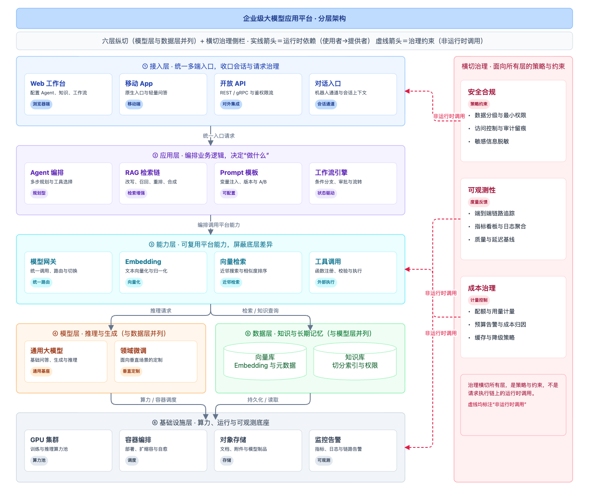
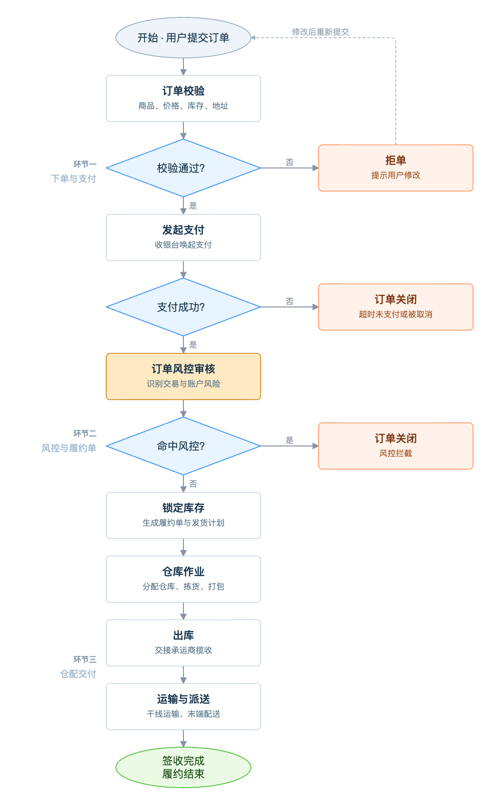

# Flow Diagram

Create editable system and process diagrams from text, documents, or code. Deliver static visuals or animated offline HTML with [FlowSVG](https://github.com/yokingma/FlowSVG).

[简体中文](README.zh-CN.md) · [Install](#install) · [User guide](docs/guides/flow-diagram-guide.md) · [Examples](skills/flow-diagram/examples/README.md) · [Contributing](CONTRIBUTING.md)

## Examples

Request flows, deployment architecture and model inference, animated with FlowSVG. See [FlowSVG image credits](docs/images/flowsvg/README.md) and [Skill-authored image details](docs/images/skill-examples/README.md).

<p align="center"></p>

<p align="center"><em>Request and response between a client and service.</em></p>

<p align="center"></p>

<p align="center"><em>Web service deployment with two application replicas.</em></p>

<p align="center"></p>

<p align="center"><em>LLM inference with Transformer layers and KV Cache reuse.</em></p>

### Static examples created with this Skill

<p align="center"></p>

<p align="center"><em>Fictional LLM platform · Tencent WorkBuddy · hy4 flash · Flow Diagram Skill.</em></p>

<p align="center"></p>

<p align="center"><em>Order fulfillment · Tencent WorkBuddy · hy4 flash · Flow Diagram Skill.</em></p>

## Install

Run in the project where you want to use the Skill:

```sh
npx skills add https://github.com/yokingma/flow-diagram-skill --skill flow-diagram
```

The [Skills CLI](https://github.com/vercel-labs/skills) selects a detected assistant or asks you to choose one. Installation is project-local by default. To install for the current user across projects, choose one of these commands:

```sh
# Codex
npx skills add https://github.com/yokingma/flow-diagram-skill --skill flow-diagram --agent codex --global

# Claude Code
npx skills add https://github.com/yokingma/flow-diagram-skill --skill flow-diagram --agent claude-code --global
```

You need **Node.js 20+ and npm**, and Git for the GitHub installation. Your assistant must support skills and local Node commands. The first diagram task installs locked runtime packages into an isolated cache and needs access to the npm registry; a complete cache can be reused offline. Your application's dependencies are not changed.

**PNG, GIF, and browser inspection also need a separately installed Chrome/Chromium executable.** JSON, HTML, and SVG generation work without it. The Skill never downloads a browser.

Restart Codex if the new Skill is not discovered. See the [installation guide](docs/guides/flow-diagram-guide.md#2-install-in-a-host) for manual installation, Windows, updates, and fixed-version checkouts. Using the Skill does not require `pnpm install` or an SDK source checkout.

## Use it

Describe what the reader should understand. The assistant chooses a diagram type, creates the diagram, checks the result and delivers the files. You can also request a specific type, such as a layered architecture diagram or logic flowchart.

In Codex, send:

```text
$flow-diagram
Create a static architecture diagram: a client calls an API service,
and the API service queries a database. The API and database belong to
the Order platform; the client is outside that boundary.
Use English labels and a light theme. Name it order-platform.
Deliver the default JSON and offline HTML, and also export SVG.
```

In Claude Code, replace the first line with `/flow-diagram`.

For animation, describe the sequence and state changes, for example:

```text
Use the flow-diagram skill to explain a request and response.
Keep the client, API, and database visible throughout. First show the
overview, then animate the request to the API, the database query,
and the response to the client. Finish with the overview.
```

When working from sources, name the files or directories the assistant may read. Include the audience, intended display size, and export formats when known. The assistant asks about gaps that affect meaning or presentation; the assistant remembers preferences you clearly set for future diagrams in this project.

## What you get

Open `.diagrams/order-platform/diagram.html` in a browser after creation. It works offline and includes playback controls; the initial state is paused.

| File | Purpose |
| --- | --- |
| `diagram.html` | Offline explanation page and player |
| `diagram.json` | Editable diagram for revisions and exports |
| `report.json`, `report.md` | Sources, completed checks, warnings, and unfinished work |
| `diagram.svg` | Static export explicitly requested in the example |

SVG, PNG, and GIF are optional exports. Page headings and introductions are not included in image exports. Keep the HTML, JSON and reports together for later revisions. See the [user guide](docs/guides/flow-diagram-guide.md) for export options and recovery.

## What it covers

- System architecture and boundaries, request/response flows, retries, state changes, and staged processing.
- Source-based diagrams with recorded references and content decisions.
- Static diagrams and step-by-step animations, with revisions and validation of existing diagrams.
- Offline explanations, web illustrations, and image assets for presentations. PPTX files and native PowerPoint shapes are outside the Skill's scope.

## Powered by FlowSVG

[FlowSVG](https://github.com/yokingma/FlowSVG) provides rendering, playback and export. This Skill helps your assistant turn source material into a clear diagram. To embed diagrams in an application, use the SDK's native browser, React, Vue or Web Component integrations.

## Development

Use Node 20+ and pnpm `10.12.1`:

```sh
pnpm install --frozen-lockfile
pnpm test
```

See [CONTRIBUTING](CONTRIBUTING.md) for tests and contribution guidelines, the [example workshop](examples/README.md#preview-the-example-library) for local previews, and the [changelog](CHANGELOG.md) for release history.

## License

[MIT](LICENSE), copyright © 2026 zac_ma. The standalone Skill includes the same [license](skills/flow-diagram/LICENSE). See [source and license attribution](CONTRIBUTING.md#source-and-license-attribution) for its FlowSVG origin. Third-party runtime packages retain their own licenses.
